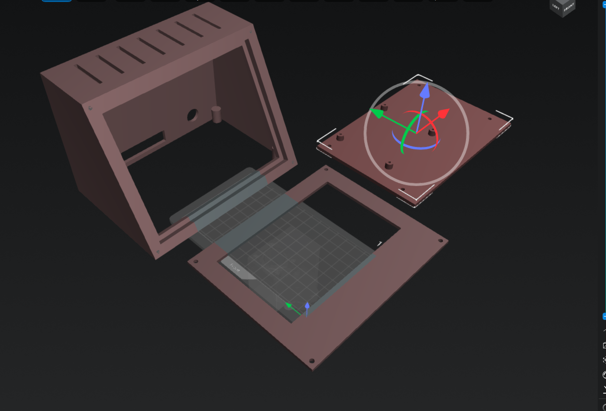

---
# 🧩 Versioning – systém dopĺňa automaticky
fm_version: "1.0.1"

# Dátum buildu – generuje skript
fm_build: "2026-11-16T13:50:35.731344+00:00"

# Poznámka k verzii – voliteľné
fm_version_comment: ""

# 🆔 IDENTITY --------------------------------------------------------

# ID generuje CLI / skript

# Unikátne UUID – generuje skript
guid: "5caab9c7-cde0-4095-9f16-71dbf41d2d0a"

# 🧭 CONTEXT ---------------------------------------------------------

# DAO / doména (knife, sdlc, q12, 7ds...) dopĺňa skript
dao: "sthdf"

# Názov zápisu – dopĺňa používateľ
title: "04.D4 Design"

# Krátky popis – dopĺňa používateľ (voliteľné)
description: "{{DESCRIPTION}}"

# 👥 AUTHORSHIP ------------------------------------------------------

# Hlavný autor – z globálneho configu
author: "Roman Kazicka"

# Zoznam autorov – generuje skript
authors:
  - "Roman Kazicka"

# 🗂 CLASSIFICATION ---------------------------------------------------

# Nadradená kategória – môže doplniť používateľ
category: ""

# Typ dokumentu (guide, case, tutorial...) – používateľ (voliteľné)
type: ""

# Priorita (low/medium/high) – voliteľné
priority: ""

# Tagy – odporúča sa 2–6 tagov.
# Typy tagov:
#   - rámce: knife, 7ds, sdlc, q12
#   - účel: tutorial, guide, pattern, case-study
#   - téma: git, backup, ai, communication
#   - úroveň: beginner, intermediate, advanced
tags: []

# 🌍 LOCALIZATION -----------------------------------------------------

# Jazyk dokumentu – doplní skript podľa štruktúry
locale: "sk"

# 🕒 LIFECYCLE --------------------------------------------------------

# Dátum vytvorenia – generuje skript
created: "2026-11-16 14:50"

# Dátum poslednej úpravy – dopĺňa človek
modified: "2026-11-16 14:50"

# Stav dokumentu – default "backlog"
status: "backlog"

# Viditeľnosť – default "public"
privacy: "public"

# ⚖ INTELLECTUAL PROPERTY -------------------------------------------

# Držiteľ práv k obsahu – dopĺňa skript
rights_holder_content: "Roman Kazicka"

# Systémový vlastník práv
rights_holder_system: "CAA / KNIFE / LetItGrow"

# Licencia
license: "CC-BY-NC-SA-4.0"

# Disclaimer
disclaimer: "Use at your own risk. Methods provided as-is; participation is voluntary and context-aware."

# Copyright
copyright: "© 2025 Roman Kazicka"

# 🔗 ORIGIN / PROVENANCE ---------------------------------------------

# Repozitár pôvodu
origin_repo: ""

# URL pôvodného repozitára
origin_repo_url: ""

# Commit pôvodu
origin_commit: ""

# Branch pôvodu
origin_branch: ""

# Systém pôvodu (CAA/KNIFE/STHDF…)
origin_system: "CAA"

# Pôvodný autor
origin_author: "Roman Kazicka"

# Importovaný zdroj
origin_imported_from: ""

# Dátum importu
origin_import_date: ""

# 🧱 RESERVED ---------------------------------------------------------

fm_reserved1: ""
fm_reserved2: ""
---

<!-- SDLC_INSTANCE_ID: PRJ_070_ST044_ST009_ST040 -->

# D4 – Design

## Dodaná sada pre výrobu

Handoff definuje cieľ: **Elecrow 5-inch LCD Display-B Rev 1.1 a Raspberry Pi 3 Model A+**. STL sú dodané výrobné siete, nie editovateľný parametrický CAD zdroj.

### Diely a výpočtové rozmery

Nasledujúce rozmery sú osovo zarovnané obálky vypočítané z binárnych STL. Jednotku mm určuje handoff; STL ju sám neukladá. Nejde o merania vytlačených dielov.

| Diel | Rozmer X × Y × Z v mm | Trojuholníky |
|---|---|---|
| [01-body.stl](../../../assets/model/01-body.stl) | 168,800 × 110,993 × 100,803 | 13 998 |
| [02-bezel.stl](../../../assets/model/02-bezel.stl) | 168,800 × 111,240 × 3,000 | 1 234 |
| [03-lid-with-pi-mount.stl](../../../assets/model/03-lid-with-pi-mount.stl) | 168,800 × 111,000 × 12,000 | 2 364 |
| [04-diffuser.stl](../../../assets/model/04-diffuser.stl) | 39,000 × 39,000 × 1,200 | 192 |
| [05-display-connector-fit-test.stl](../../../assets/model/05-display-connector-fit-test.stl) | 35,400 × 75,000 × 30,030 | 886 |

[PRINT-AND-ASSEMBLY.txt](../../../assets/model/PRINT-AND-ASSEMBLY.txt) uvádza orientáciu dielov, mierku a kontrolu konektorov. Jeho autor hlási uzavreté siete a digitálnu kontrolu nominálnych obálok elektroniky. Táto analýza nezávisle overila binárnu dĺžku súborov, počty trojuholníkov a obálky; fyzický fit a výsledok tlače nie sú potvrdené.

Kryt podľa používateľa zatiaľ nie je vytlačený. TODO: zdroj CAD, autorstvo/revízia, vzťah snímky k tejto sade, meranie displeja a skúška fit-test dielu.

## Navigácia

- [↩️ Späť](../index.md)

Podklady a rozlíšenie stavov: [evidencia zdrojov](../01.D1-Management/05.WorkActivitiesEvidence/index.md).
