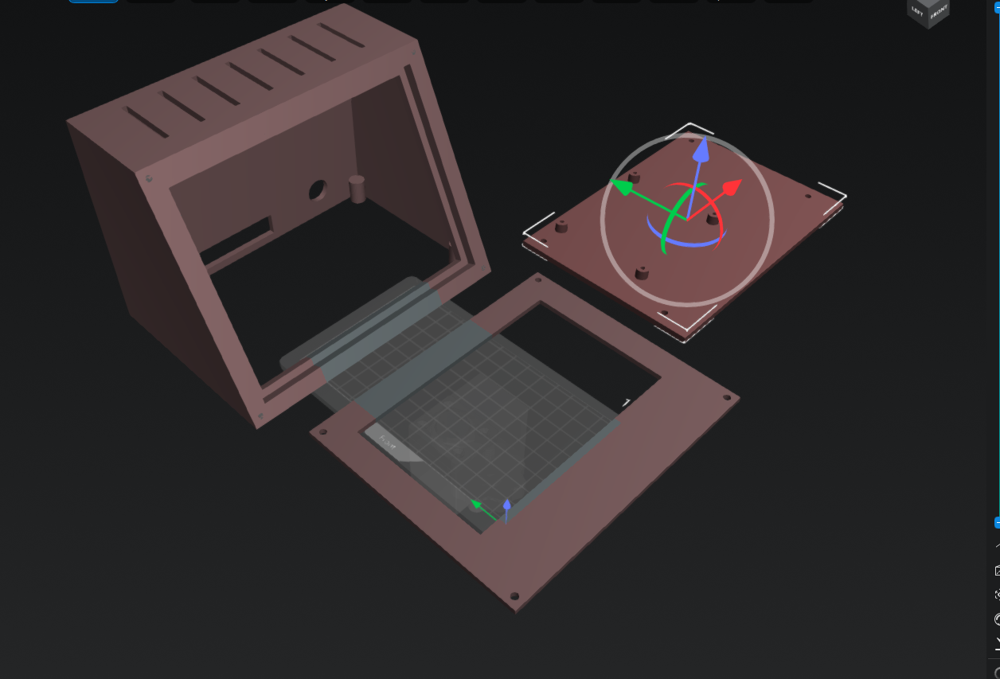

---
# 🧩 Versioning – systém dopĺňa automaticky
fm_version: "1.0.1"

# Dátum buildu – generuje skript
fm_build: "2026-11-16T13:50:35.717840+00:00"

# Poznámka k verzii – voliteľné
fm_version_comment: ""

# 🆔 IDENTITY --------------------------------------------------------

# ID generuje CLI / skript

# Unikátne UUID – generuje skript
guid: "75e7c1bb-f45b-4e1c-8bae-c34337c415a3"

# 🧭 CONTEXT ---------------------------------------------------------

# DAO / doména (knife, sdlc, q12, 7ds...) dopĺňa skript
dao: "sthdf"

# Názov zápisu – dopĺňa používateľ
title: "projects"

# Krátky popis – dopĺňa používateľ (voliteľné)
description: "{{DESCRIPTION}}"

# 👥 AUTHORSHIP ------------------------------------------------------

# Hlavný autor – z globálneho configu
author: "Roman Kazicka"

# Zoznam autorov – generuje skript
authors:
  - "Roman Kazicka"

# 🗂 CLASSIFICATION ---------------------------------------------------

# Nadradená kategória – môže doplniť používateľ
category: ""

# Typ dokumentu (guide, case, tutorial...) – používateľ (voliteľné)
type: ""

# Priorita (low/medium/high) – voliteľné
priority: ""

# Tagy – odporúča sa 2–6 tagov.
# Typy tagov:
#   - rámce: knife, 7ds, sdlc, q12
#   - účel: tutorial, guide, pattern, case-study
#   - téma: git, backup, ai, communication
#   - úroveň: beginner, intermediate, advanced
tags: []

# 🌍 LOCALIZATION -----------------------------------------------------

# Jazyk dokumentu – doplní skript podľa štruktúry
locale: "sk"

# 🕒 LIFECYCLE --------------------------------------------------------

# Dátum vytvorenia – generuje skript
created: "2026-11-16 14:50"

# Dátum poslednej úpravy – dopĺňa človek
modified: "2026-11-16 14:50"

# Stav dokumentu – default "backlog"
status: "backlog"

# Viditeľnosť – default "public"
privacy: "public"

# ⚖ INTELLECTUAL PROPERTY -------------------------------------------

# Držiteľ práv k obsahu – dopĺňa skript
rights_holder_content: "Roman Kazicka"

# Systémový vlastník práv
rights_holder_system: "CAA / KNIFE / LetItGrow"

# Licencia
license: "CC-BY-NC-SA-4.0"

# Disclaimer
disclaimer: "Use at your own risk. Methods provided as-is; participation is voluntary and context-aware."

# Copyright
copyright: "© 2025 Roman Kazicka"

# 🔗 ORIGIN / PROVENANCE ---------------------------------------------

# Repozitár pôvodu
origin_repo: ""

# URL pôvodného repozitára
origin_repo_url: ""

# Commit pôvodu
origin_commit: ""

# Branch pôvodu
origin_branch: ""

# Systém pôvodu (CAA/KNIFE/STHDF…)
origin_system: "CAA"

# Pôvodný autor
origin_author: "Roman Kazicka"

# Importovaný zdroj
origin_imported_from: ""

# Dátum importu
origin_import_date: ""

# 🧱 RESERVED ---------------------------------------------------------

fm_reserved1: ""
fm_reserved2: ""
---

<!-- SDLC_INSTANCE_ID: PRJ_070_ST044_ST009_ST040 -->

# 🎓 Projekty – Dashboard

## MemoBox Junior – prehľad projektu

**Kód:** PRJ_070_ST044_ST009_ST040. **Názov:** MemoBox Junior, potvrdený používateľom.

Cieľom je stolové zariadenie na hry s krátkodobou pamäťou. Raspberry Pi má zobrazovať pamäťové a reakčné hry; dodaný kód obsahuje Memory, Chimp, Whack-a-Mole, Rock-Paper-Scissors a Reaction Time na dotykovom displeji. Vlastný 3D tlačený kryt má spojiť elektroniku do jedného zariadenia. Poster navrhuje využitie v materských školách; tento segment zatiaľ nie je potvrdený používateľským overením.

| ST ID | Člen tímu |
|---|---|
| ST044 | Sakalosh Oleksandr, Bc. |
| ST009 | Lykhachov Yehor, Bc. |
| ST040 | Mareček Ján, Bc. |

### Aktuálny stav podľa dostupných podkladov

| Oblasť | Doložený stav | Čo chýba |
|---|---|---|
| Koncept a poster | Dostupný poster a opis hier | Potvrdenie názvu a cieľovej skupiny |
| Softvér | Prvá verzia vyvinutá a testovaná na Pi podľa používateľa | Kód dostupný; TODO verzie, presný rozsah skúšok a screenshoty |
| Hardvér | Komponenty objednané, dodané a testované podľa používateľa | Presné modely, konfigurácia a protokoly |
| Kryt | Snímka modelu; STL zdieľané v chate | STL a handoff dostupné; TODO CAD, fyzický fit a tlač |
| Systémový model | Hlásená práca v EA | EA súbor a exporty diagramov |
| Výroba a montáž | Kryt podľa používateľa nie je vytlačený | Termín tlače, hotový kryt, fotografie montáže |
| Overenie | Test prvej verzie na Pi potvrdený; protokol chýba | Výsledky podľa navrhnutých scenárov |

### Čítanie dokumentácie

- [7Ds – riadenie projektu](./7ds/index.md)
- [Q12 – hodnota a životný cyklus](./q12/index.md)
- [SDLC – technické riešenie](./sdlc/index.md)
- [Project Summary](../students/project-summary/index.md)
- [Výstupy a ich obmedzenia](../students/project-outcomes/index.md)
- [Odovzdávané sekcie](../students/index.md)

**Najbližšie kroky:** potvrdiť chýbajúce údaje, doplniť EA a parametrický CAD, overiť rozmery a káble, dohodnúť výrobu, zmontovať a zaznamenať testy. Termín a rozpočet: **TODO**.

## Podrobné sekcie

- [7ds](./7ds/index.md)
- [q12](./q12/index.md)
- [sdlc](./sdlc/index.md)

- [↩️ Späť](../index.md)

Podklady a rozlíšenie stavov: [evidencia zdrojov](7ds/01.D1-Management/05.WorkActivitiesEvidence/index.md).

## Dodané technické zdroje

- [memory.py – päť hier](../assets/software/memory.py)
- [STL a rozmery](./7ds/04.D4-Design/index.md)
- [Výrobný handoff](../assets/model/PRINT-AND-ASSEMBLY.txt)
