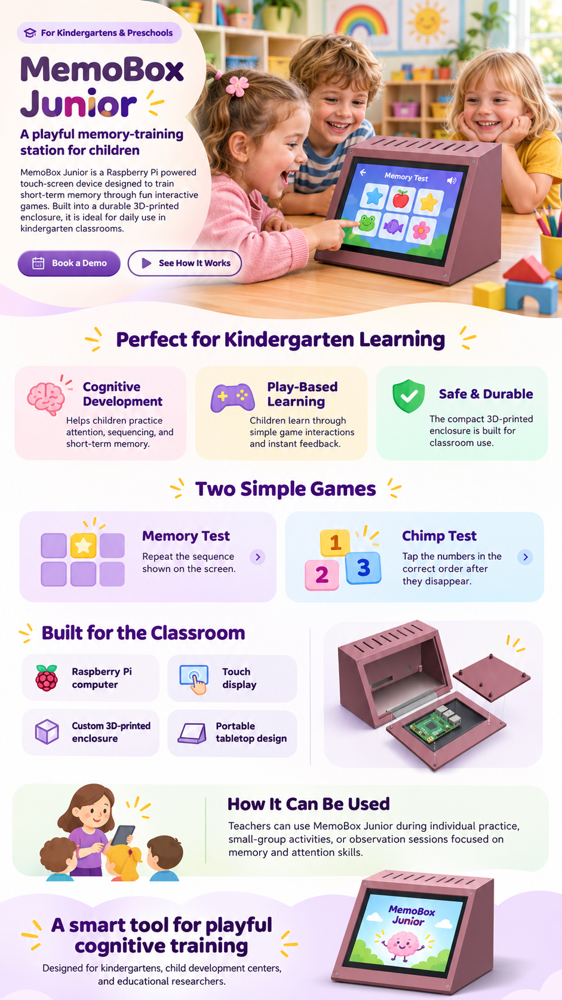

---
# 🧩 Versioning – systém dopĺňa automaticky
fm_version: "1.0.1"

# Dátum buildu – generuje skript
fm_build: "2026-11-16T13:50:35.762248+00:00"

# Poznámka k verzii – voliteľné
fm_version_comment: ""

# 🆔 IDENTITY --------------------------------------------------------

# ID generuje CLI / skript

# Unikátne UUID – generuje skript
guid: "31d10967-741b-466b-bd4b-65e9a6c3c2f4"

# 🧭 CONTEXT ---------------------------------------------------------

# DAO / doména (knife, sdlc, q12, 7ds...) dopĺňa skript
dao: "sthdf"

# Názov zápisu – dopĺňa používateľ
title: "pitch presentation"

# Krátky popis – dopĺňa používateľ (voliteľné)
description: "{{DESCRIPTION}}"

# 👥 AUTHORSHIP ------------------------------------------------------

# Hlavný autor – z globálneho configu
author: "Roman Kazicka"

# Zoznam autorov – generuje skript
authors:
  - "Roman Kazicka"

# 🗂 CLASSIFICATION ---------------------------------------------------

# Nadradená kategória – môže doplniť používateľ
category: ""

# Typ dokumentu (guide, case, tutorial...) – používateľ (voliteľné)
type: ""

# Priorita (low/medium/high) – voliteľné
priority: ""

# Tagy – odporúča sa 2–6 tagov.
# Typy tagov:
#   - rámce: knife, 7ds, sdlc, q12
#   - účel: tutorial, guide, pattern, case-study
#   - téma: git, backup, ai, communication
#   - úroveň: beginner, intermediate, advanced
tags: []

# 🌍 LOCALIZATION -----------------------------------------------------

# Jazyk dokumentu – doplní skript podľa štruktúry
locale: "sk"

# 🕒 LIFECYCLE --------------------------------------------------------

# Dátum vytvorenia – generuje skript
created: "2026-11-16 14:50"

# Dátum poslednej úpravy – dopĺňa človek
modified: "2026-11-16 14:50"

# Stav dokumentu – default "backlog"
status: "backlog"

# Viditeľnosť – default "public"
privacy: "public"

# ⚖ INTELLECTUAL PROPERTY -------------------------------------------

# Držiteľ práv k obsahu – dopĺňa skript
rights_holder_content: "Roman Kazicka"

# Systémový vlastník práv
rights_holder_system: "CAA / KNIFE / LetItGrow"

# Licencia
license: "CC-BY-NC-SA-4.0"

# Disclaimer
disclaimer: "Use at your own risk. Methods provided as-is; participation is voluntary and context-aware."

# Copyright
copyright: "© 2025 Roman Kazicka"

# 🔗 ORIGIN / PROVENANCE ---------------------------------------------

# Repozitár pôvodu
origin_repo: ""

# URL pôvodného repozitára
origin_repo_url: ""

# Commit pôvodu
origin_commit: ""

# Branch pôvodu
origin_branch: ""

# Systém pôvodu (CAA/KNIFE/STHDF…)
origin_system: "CAA"

# Pôvodný autor
origin_author: "Roman Kazicka"

# Importovaný zdroj
origin_imported_from: ""

# Dátum importu
origin_import_date: ""

# 🧱 RESERVED ---------------------------------------------------------

fm_reserved1: ""
fm_reserved2: ""
---

<!-- SDLC_INSTANCE_ID: PRJ_070_ST044_ST009_ST040 -->

# 🎤 Pitch Presentation

## Osnova pitchu – návrh, 5–7 minút

1. **Problém / hypotéza:** pedagóg potrebuje jednoduchú stolovú aktivitu zameranú na pamäť a pozornosť. TODO overiť rozhovorom s pedagógom.
2. **Riešenie:** Raspberry Pi, dotykový displej, Memory test a Chimp test v jednom 3D kryte.
3. **Hodnota:** priama interakcia a opakovateľné herné úlohy. Rozvoj pamäti zostáva hypotézou.
4. **Stav:** model a poster sú dostupné, prvá herná verzia bola podľa používateľa testovaná na Pi; kryt nie je vytlačený.
5. **Tím:** ST044, ST009, ST040; príspevky sú evidované v Project Summary; TODO formálne roly.
6. **Výzva:** zabezpečiť výrobu, overiť prototyp a získať spätnú väzbu.

### Vizuálny podklad

Poster používa marketingové tvrdenia o odolnosti, bezpečnosti a prínose učenia. Dokumentácia ich nepovažuje za overené vlastnosti. Zobrazené deti a zariadenie nie sú dôkazom používateľského testovania.

**TODO:** finálne slajdy, hovoriaci, termín, ukážka funkčného zariadenia a detailné výsledky skúšok. Cenový a obchodný model nie je dohodnutý.

## Navigácia

- [↩️ Späť](../index.md)

Podklady a rozlíšenie stavov: [evidencia zdrojov](../../projects/7ds/01.D1-Management/05.WorkActivitiesEvidence/index.md).
